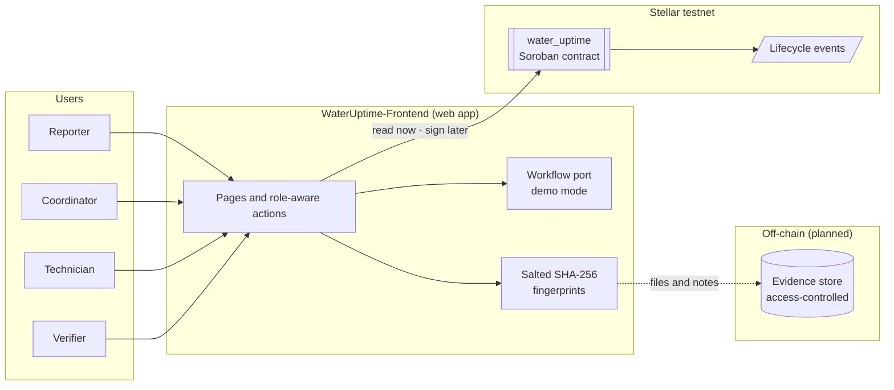

# Architecture overview

A short map of how WaterUptime fits together. For details see [docs/system-architecture.md](docs/system-architecture.md).

## Design goal

Keep the blockchain responsible for a **small set of shared rules**: who may act, in what order, and an append-only record of what they submitted. Keep everything sensitive or bulky **off-chain**.

| Component | Repository | Responsible for | Not responsible for |
|---|---|---|---|
| Smart contract | [WaterUptime-SmartContract](https://github.com/WaterUptime/WaterUptime-SmartContract) | Roles, state transitions, invariants, audit history, events | Personal data, files, the truth of field observations, payments |
| Web app | [WaterUptime-Frontend](https://github.com/WaterUptime/WaterUptime-Frontend) | Role-aware UI, fingerprinting, plain-language errors, demo mode | Being the system of record |
| Evidence store | *planned* | Photos, logs and notes behind access control | Anything public |
| Existing WASH systems | *external* | Remaining the system of record where they already are | — |

## Key decisions

1. **Minimal on-chain data.** Only random 32-byte IDs, salted fingerprints, addresses, statuses and timestamps.
2. **Stored admin, not passed-in admin.** Admin-only functions require the signature of the admin stored at initialisation.
3. **One open job per water point.** This stops duplicate reports. Mistaken reports are cancelled, not faked through to closure.
4. **Bounded history.** At most 50 audit entries per job, so rework loops can't grow storage without limit. In contract `v0.1.1` a job could reach the limit with no room left to close or cancel it. The fix keeps room for the final steps and is in review ([contract #13](https://github.com/WaterUptime/WaterUptime-SmartContract/pull/13)).
5. **Demo mode mirrors the contract.** The frontend's demo runs a port of the state machine with the same rules and errors, tested against the same cases.
6. **SDK loaded on demand.** The Stellar SDK is loaded only for testnet mode, to keep the default bundle small for low-bandwidth users.

## Trust model in one paragraph

The ledger gives a shared record of what an authorised account submitted, and which rules were enforced. It cannot tell whether a photo is genuine, whether water flows reliably, or whether a repair meets safety standards. Those depend on credible human verification, accountable roles and sound governance. See [security and privacy](docs/security-and-privacy.md).
