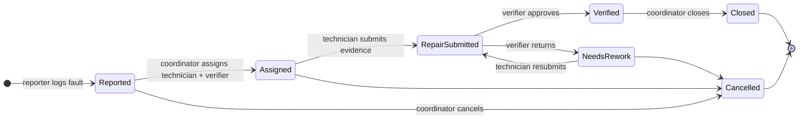

# WaterUptime

**Open-source maintenance and verification infrastructure for community water systems.**

When a community water point breaks, the fault report, the repair assignment, the evidence of work and the independent sign-off are often held by different people in different places. WaterUptime explores whether one shared, verifiable workflow can help water committees, technicians, verifiers and programme partners agree on what was repaired, who checked it, and when service came back.

> **Status: early prototype.** Synthetic data and Stellar **testnet** only. The problem is a hypothesis that still needs validation with water-service stakeholders ([how we plan to test it](#real-world-validation)). No government, NGO, UNDP or Stellar Development Foundation partnership or endorsement is claimed.

This repository is the project hub: product docs, architecture, roadmap and the compatibility record. Code lives in two repositories:

| Repository | What's inside |
|---|---|
| **[WaterUptime-SmartContract](https://github.com/WaterUptime/WaterUptime-SmartContract)** | Soroban (Rust) contract that enforces roles and the repair state machine, plus tests, testnet deployment details and a demo script |
| **[WaterUptime-Frontend](https://github.com/WaterUptime/WaterUptime-Frontend)** | React + TypeScript web app: an interactive demo and a read-only view of the live testnet contract |

## How it works



- The technician and the verifier must be **different people**, and only the assigned person can act at each step.
- Every step is appended to the job's **audit history**, and nothing is erased, including rejected evidence.
- Names, photos, coordinates and documents stay **off-chain**; only opaque IDs and salted fingerprints go on-chain.
- The record shows *what an authorised person submitted*. It does **not** by itself prove that a repair physically happened or that water is safe.

Details: [contract state machine](docs/contract-state-machine.md) · [architecture](ARCHITECTURE.md) · [security and privacy](docs/security-and-privacy.md)

## What works today

| Capability | Status | Where |
|---|---|---|
| Water-point registry with opaque IDs; activate/deactivate | ✅ Implemented and tested | Contract |
| Reporter permissions (grant/revoke) | ✅ Implemented and tested | Contract |
| Full lifecycle with rework loop and cancellation | ✅ Implemented and tested | Contract |
| Role separation (technician ≠ verifier) and per-step authorisation | ✅ Implemented and tested | Contract |
| On-chain audit history and lifecycle events | ✅ Implemented and tested | Contract |
| Shared testnet deployment with demo jobs | ✅ Live on testnet | Contract `docs/TESTNET.md` |
| Deployed contract source-verified on an explorer (attested build) | ✅ Verified on [Stellar Expert](https://stellar.expert/explorer/testnet/contract/CD5V5AJCWEP25CVVFQ3J5E54AFOB6JFYO4MIWBJSIPECMEM3PHZ6TCLX) | Contract `v0.1.1` |
| Web app: overview, water points, jobs, verification queue, fault reporting | ✅ Implemented (demo data) | Frontend |
| Demo mode that enforces the contract's rules in the browser | ✅ Implemented and tested | Frontend |
| Read-only view of the live testnet contract | ✅ Implemented | Frontend |
| Signing actions with a wallet on testnet | 🔜 Planned ([Frontend#2](https://github.com/WaterUptime/WaterUptime-Frontend/issues/2)) | Frontend |
| Evidence attachments (photos, logs) with fingerprints | 🔜 Planned ([Frontend#3](https://github.com/WaterUptime/WaterUptime-Frontend/issues/3)) | Frontend |
| Admin handover, configurable role-separation policy, job index | 🔜 Planned ([Contract#2–4](https://github.com/WaterUptime/WaterUptime-SmartContract/issues)) | Contract |
| Off-chain evidence store with access control | 📋 Design needed | — |
| Integration with existing WASH systems (e.g. WASHIMS) | 📋 Only after permission and discovery | — |
| Payments, mainnet, real data | 🚫 Out of scope for v0 | — |

The full plan is in the [roadmap](ROADMAP.md).

## Run it

### Try the web app (no blockchain tools needed)

```bash
git clone https://github.com/WaterUptime/WaterUptime-Frontend.git
cd WaterUptime-Frontend
npm install
npm run dev            # open http://localhost:5173
```

1. **Demo data** (default): use the **Acting as** selector in the header to switch roles, then report a fault, assign it, submit a repair, verify it and close it. Nothing leaves your browser.
2. **Testnet**: switch the data source to read the live testnet contract (read-only).

Requires Node 24.

### Build and test the contract

```bash
git clone https://github.com/WaterUptime/WaterUptime-SmartContract.git
cd WaterUptime-SmartContract
rustup target add wasm32v1-none
cargo test                     # unit tests
stellar contract build         # builds the WASM
scripts/testnet-demo.sh        # deploy your own testnet instance and run a full job
```

Requires Rust (stable) and the [Stellar CLI](https://developers.stellar.org/docs/tools/cli).

## Compatibility

Versions that have been run together, newest first. Use these tags when checking out both repositories. The first row is the current shared deployment.

| Frontend | Contract (source) | Testnet contract ID | Tested | How it was tested |
|---|---|---|---|---|
| [`v0.1.0`](https://github.com/WaterUptime/WaterUptime-Frontend/tree/v0.1.0) (`35cee32`) with `VITE_CONTRACT_ID` override | [`v0.1.1`](https://github.com/WaterUptime/WaterUptime-SmartContract/tree/v0.1.1) (`38760fa`, [attested build](https://github.com/WaterUptime/WaterUptime-SmartContract/releases/tag/v0.1.1_water_uptime_cli28.1.0)) | [`CD5V5AJCWEP25CVVFQ3J5E54AFOB6JFYO4MIWBJSIPECMEM3PHZ6TCLX`](https://stellar.expert/explorer/testnet/contract/CD5V5AJCWEP25CVVFQ3J5E54AFOB6JFYO4MIWBJSIPECMEM3PHZ6TCLX) (source verified) | 2026-10-27 | Testnet mode loaded both demo jobs (closed with 7 events; cancelled) from the deployed contract in headless Chrome, with no console errors; the app's contract link used the new ID. Read-only; wallet writes not built yet. |
| [`v0.1.0`](https://github.com/WaterUptime/WaterUptime-Frontend/tree/v0.1.0) (`35cee32`) | [`v0.1.0`](https://github.com/WaterUptime/WaterUptime-SmartContract/tree/v0.1.0) (`ef23869`) | `CDRNO3OO3JCIWRNJIDRPH3UQ6ZX7GRTDQUPMJP4B5IVKUMNUNVHC3ZQO` (superseded by v0.1.1) | 2026-10-27 | Testnet mode loaded jobs, history and water points from the deployed contract in headless Chrome (read-only). Demo-mode rules checked against a port of the contract's test suite. Writes from the app are not tested yet, because wallet signing isn't built. |

**Adding a row:** when either side changes the contract interface (functions, types, errors or events), or a new contract is deployed, run the frontend against it and add a row with both SHAs (or tags), the contract ID, the date, and what you checked. Never remove old rows. See [CONTRIBUTING.md](CONTRIBUTING.md#updating-the-compatibility-table).

## Real-world validation

The software is the easy part. Before claiming any impact, WaterUptime has to show that the problem exists in a specific place, and that a shared ledger helps more than a conventional database would.

1. **Discovery:** 8–10 structured conversations with water committees, technicians, LGA WASH staff and at least one implementing organisation, mapping how faults are reported, assigned, evidenced, verified and paid for today. → [User research plan](docs/user-research.md)
2. **Institutional mapping:** who owns the asset, who may assign and verify work, who controls the budget and the data. No one is named as a partner without a formal agreement.
3. **Table-top testing:** walk stakeholders through the testnet demonstrator using realistic scenarios, comparing time and steps with today's process. **Revise or stop if the ledger adds little value.**
4. **Supervised pilot:** only with an accountable implementation partner, security and data-protection reviews, and explicit approvals.

Each stage has a decision gate. → [Implementation pathway](docs/implementation-pathway.md) · [Problem statement](docs/problem-statement.md)

## Documentation

| Document | Covers |
|---|---|
| [Problem statement](docs/problem-statement.md) | The hypothesis, who is affected, and what we don't yet know |
| [Product requirements](docs/product-requirements.md) | Users, MVP workflow, requirements, exclusions, success criteria |
| [Architecture](ARCHITECTURE.md) · [System architecture](docs/system-architecture.md) | Components, data flow, trust model |
| [Contract state machine](docs/contract-state-machine.md) | Statuses, transitions, roles, errors, events |
| [Security and privacy](docs/security-and-privacy.md) | Threat model, data minimisation, what the ledger can't prove |
| [Integration guide](docs/integration-guide.md) | Reading the contract, fingerprints, events, integrating other systems |
| [User research](docs/user-research.md) | Discovery plan, interview guide, consent, findings log |
| [Implementation pathway](docs/implementation-pathway.md) | Staged route from prototype to a responsible pilot |
| [Roadmap](ROADMAP.md) | Milestones and decision gates |
| [Drips Wave backlog](docs/drips-wave-backlog.md) | Contributor issues, dependencies and the Wave approval checklist |

## Contributing

Scoped issues with acceptance criteria are open in each repository; look for `good first issue`. Read [CONTRIBUTING.md](CONTRIBUTING.md) and the [Code of Conduct](https://github.com/WaterUptime/.github/blob/main/CODE_OF_CONDUCT.md). Report vulnerabilities privately; see [SECURITY.md](SECURITY.md).

## License

[MIT](LICENSE)
