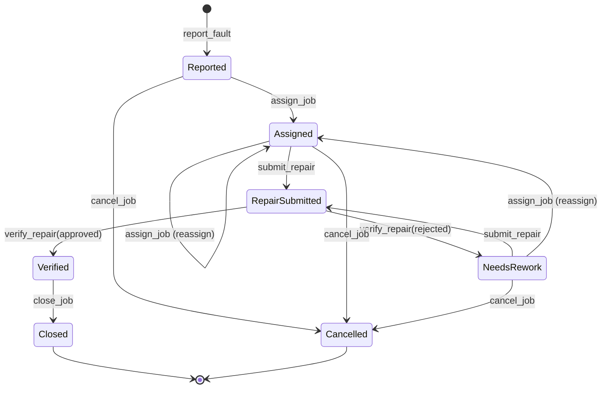

# Contract state machine

This describes the `water_uptime` Soroban contract as of [`v0.1.1`](https://github.com/WaterUptime/WaterUptime-SmartContract/tree/v0.1.1) (contract logic unchanged since `v0.1.0`). The **code is the source of truth**: [`contracts/water_uptime/src/lib.rs`](https://github.com/WaterUptime/WaterUptime-SmartContract/blob/main/contracts/water_uptime/src/lib.rs). The full interface reference is in the contract repo's [`docs/CONTRACT_INTERFACE.md`](https://github.com/WaterUptime/WaterUptime-SmartContract/blob/main/docs/CONTRACT_INTERFACE.md).

## Statuses

| Status | Meaning | Final? |
|---|---|---|
| `Reported` | Fault logged, waiting for the coordinator | |
| `Assigned` | Technician and verifier assigned; repair under way off-chain | |
| `RepairSubmitted` | Technician has submitted evidence; waiting for the verifier | |
| `NeedsRework` | Verifier returned the repair; technician must resubmit | |
| `Verified` | Verifier approved; waiting for the coordinator to close | |
| `Closed` | Done; the water point can receive new reports | ✔ |
| `Cancelled` | Withdrawn (mistaken or duplicate report); history kept | ✔ |

## Transitions

| Function | Who must sign | Allowed from | Moves to | Audit action | Event |
|---|---|---|---|---|---|
| `report_fault(reporter, water_point_id, fault_reference)` | authorised reporter | water point registered, active, no open job | `Reported` | `Reported` | `fault_reported` |
| `assign_job(job_id, technician, verifier)` | admin | `Reported`, `Assigned`, `NeedsRework` | `Assigned` | `Assigned` | `job_assigned` |
| `submit_repair(technician, job_id, repair_reference)` | assigned technician | `Assigned`, `NeedsRework` | `RepairSubmitted` | `RepairSubmitted` | `repair_submitted` |
| `verify_repair(verifier, job_id, verification_reference, true)` | assigned verifier | `RepairSubmitted` | `Verified` | `RepairApproved` | `repair_approved` |
| `verify_repair(verifier, job_id, verification_reference, false)` | assigned verifier | `RepairSubmitted` | `NeedsRework` | `RepairReturned` | `repair_returned` |
| `close_job(job_id)` | admin | `Verified` | `Closed` | `Closed` | `job_closed` |
| `cancel_job(job_id, reason_reference)` | admin | `Reported`, `Assigned`, `NeedsRework` | `Cancelled` | `Cancelled` | `job_cancelled` |

Notes:

- **Reassignment** (`assign_job` on an already-assigned job) is allowed until evidence is submitted. Once a repair awaits verification, the verifier must decide first.
- **Cancellation** is blocked in `RepairSubmitted` for the same reason, and impossible from `Verified` or a final status.
- `close_job` and `cancel_job` free the water point (`open_job = None`) so it can receive a new report.

## Setup and registry functions

| Function | Who must sign | Effect | Event |
|---|---|---|---|
| `initialize(admin)` | `admin` | One-time; stores the coordinator | — |
| `set_reporter(reporter, allowed)` | admin | Grant or revoke reporting; existing jobs unaffected | `reporter_updated` |
| `register_water_point(water_point_id, metadata_hash)` | admin | New active water point | `water_point_registered` |
| `set_water_point_active(water_point_id, active)` | admin | Inactive points reject new reports; an open job continues | `water_point_status_changed` |

Read-only: `get_admin`, `is_reporter`, `get_water_point`, `get_job`, `get_job_history`, `job_count`.

## Invariants

1. Admin-only functions require the signature of the **stored** admin. The admin is never passed in as an argument.
2. A report needs an authorised reporter, a registered **active** water point, and no open job on that point.
3. `technician ≠ verifier`. A rejected assignment leaves the job unchanged.
4. Only the assigned technician submits; only the assigned verifier decides.
5. Only `RepairSubmitted` can become `Verified` or `NeedsRework`.
6. Only `Verified` can become `Closed`.
7. `Closed` and `Cancelled` accept no further workflow actions.
8. Every transition appends exactly one `AuditEntry { action, actor, reference, timestamp }`. Entries are never modified or removed.
9. A job holds at most **50** audit entries (`MAX_HISTORY_LEN`). Beyond that, actions fail with `HistoryLimitReached`, and the job should be cancelled and reopened.
10. A failed call changes nothing: Soroban rolls back all writes and events.

## Errors

| Code | Name | Typical cause |
|---|---|---|
| 1 | `AlreadyInitialized` | `initialize` called twice |
| 2 | `NotInitialized` | Any call before `initialize` |
| 3 | `WaterPointExists` | Registering an ID twice |
| 4 | `WaterPointNotFound` | Unknown water point |
| 5 | `WaterPointInactive` | Reporting on a deactivated point |
| 6 | `ReporterNotAuthorized` | Caller isn't an authorised reporter |
| 7 | `OpenJobExists` | Point already has an open job |
| 8 | `JobNotFound` | Unknown job ID |
| 9 | `InvalidTransition` | Action not allowed in the current status |
| 10 | `SameTechnicianAndVerifier` | Role-separation violation |
| 11 | `NotAssignedTechnician` | Caller isn't the job's technician |
| 12 | `NotAssignedVerifier` | Caller isn't the job's verifier |
| 13 | `HistoryLimitReached` | Job has 50 audit entries |

Authorisation failures from a missing signature are host errors, not contract errors. Apps should explain them as "this account isn't allowed to do that".

## Events

The first topic is the event name; the second is the indexed field. Data is a map of the remaining fields.

| Event | Indexed | Data |
|---|---|---|
| `water_point_registered` | `water_point_id` | `metadata_hash` |
| `water_point_status_changed` | `water_point_id` | `active` |
| `reporter_updated` | `reporter` | `allowed` |
| `fault_reported` | `job_id` | `water_point_id`, `reporter`, `fault_reference` |
| `job_assigned` | `job_id` | `technician`, `verifier` |
| `repair_submitted` | `job_id` | `technician`, `repair_reference` |
| `repair_approved` | `job_id` | `verifier`, `verification_reference` |
| `repair_returned` | `job_id` | `verifier`, `verification_reference` |
| `job_closed` | `job_id` | `water_point_id` |
| `job_cancelled` | `job_id` | `water_point_id`, `reason_reference` |

## Keeping things in sync

The frontend's demo mode runs a port of this state machine ([`src/domain/workflow.ts`](https://github.com/WaterUptime/WaterUptime-Frontend/blob/main/src/domain/workflow.ts)) with tests mirroring the contract's. Any change here needs, in the same release cycle:

1. a contract change with positive and negative tests;
2. matching updates to the frontend's `types.ts`, `workflow.ts`, `workflow.test.ts` and `errors.ts`;
3. an update to this document and to `docs/CONTRACT_INTERFACE.md`;
4. a new row in the [compatibility table](../README.md#compatibility).
