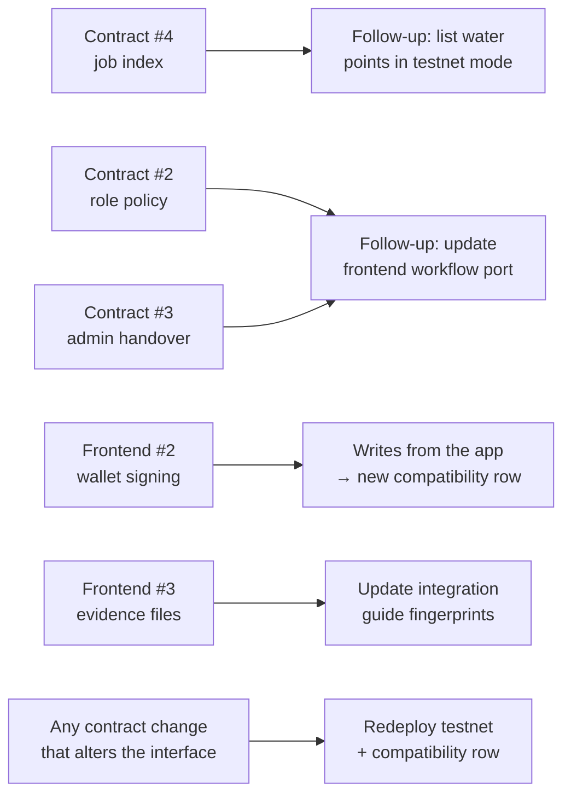

# Drips Wave backlog

Contributor backlog for [Drips Wave](https://www.drips.network/) cycles. It tracks which issues are ready, how they fit together, and what still has to happen before WaterUptime applies to a Wave.

Last updated: 2026-10-27, against contract `v0.1.1` and frontend `v0.1.0`.

> Rewards follow the official rules of the Wave programme only. Maintainers never promise payment outside them. Read the current Drips maintainer docs before each cycle; programme details and labels change.

## Repository approval checklist

| Item | Status | Evidence |
|---|---|---|
| Public repositories with independent history | ✅ | [Contract](https://github.com/WaterUptime/WaterUptime-SmartContract), [frontend](https://github.com/WaterUptime/WaterUptime-Frontend), [hub](https://github.com/WaterUptime/WaterUptime), all created fresh in this organisation |
| README states problem hypothesis, MVP, setup, status and non-goals | ✅ | [Hub README](../README.md), plus each repository's README |
| Contract builds and tests pass in CI | ✅ | fmt, clippy, 35 tests and WASM build on every PR; green on `main` |
| Frontend builds and tests pass in CI | ✅ | Typecheck, tests and build on every PR; green on `main` |
| No secrets, personal data or production keys in source control | ✅ | Full git history scanned for secret-key patterns (0 hits); demo data is fictional |
| Architecture and threat assumptions documented | ✅ | [Architecture](../ARCHITECTURE.md), [security and privacy](security-and-privacy.md) |
| Demo uses synthetic data and Stellar testnet only | ✅ | [Testnet deployment](https://github.com/WaterUptime/WaterUptime-SmartContract/blob/v0.1.0/docs/TESTNET.md); app labels demo and testnet data |
| At least 4–6 scoped issues with acceptance criteria and test expectations | ✅ | 10 open issues (below) |
| Contribution guide, Code of Conduct, private security reporting | ✅ | [Org `.github`](https://github.com/WaterUptime/.github); private vulnerability reporting enabled on all repositories |
| Tagged, compatible releases | ✅ | Contract `v0.1.1`, frontend `v0.1.0`; [compatibility table](../README.md#compatibility) |
| Deployed contract source-verified on an explorer | ✅ | [Stellar Expert](https://stellar.expert/explorer/testnet/contract/CD5V5AJCWEP25CVVFQ3J5E54AFOB6JFYO4MIWBJSIPECMEM3PHZ6TCLX) shows the source as verified; attested GitHub Actions build |
| Confirm the current Wave programme and cycle | ☐ | Maintainer action |
| Apply through the Drips app; wait for repository approval | ☐ | Maintainer action; organisers control approval |
| Add the programme's label to the issues selected for the cycle | ☐ | After approval |

## Open issues

Complexity uses the original backlog's scale: **Trivial**, **Medium** or **High**.

### Smart contract

| Issue | Complexity | Labels | Changes interface? | Notes |
|---|---|---|---|---|
| [#5 Exact payloads for every event](https://github.com/WaterUptime/WaterUptime-SmartContract/issues/5) | Trivial–Medium | `contract`, `good first issue` | No | Tests only; best first contribution |
| [#7 Data minimisation and public-ledger risks](https://github.com/WaterUptime/WaterUptime-SmartContract/issues/7) | Trivial–Medium | `docs` | No | Docs only; complements [security and privacy](security-and-privacy.md) |
| [#6 TTL extension entry points](https://github.com/WaterUptime/WaterUptime-SmartContract/issues/6) | Medium | `contract` | Yes (adds functions) | |
| [#4 Per-water-point job index](https://github.com/WaterUptime/WaterUptime-SmartContract/issues/4) | Medium | `contract` | Yes (adds functions and storage) | Unlocks listing water points in the app's testnet mode |
| [#2 Configurable role-separation policy](https://github.com/WaterUptime/WaterUptime-SmartContract/issues/2) | Medium | `contract`, `security-sensitive` | Yes (adds functions and errors) | Needs the frontend workflow port updated |
| [#3 Two-step admin handover](https://github.com/WaterUptime/WaterUptime-SmartContract/issues/3) | Medium | `contract`, `security-sensitive` | Yes (adds functions, error and events) | Needs the frontend workflow port updated |
| [#8 TypeScript bindings in CI](https://github.com/WaterUptime/WaterUptime-SmartContract/issues/8) | Medium | `ci` | No | |

### Frontend

| Issue | Complexity | Labels | Notes |
|---|---|---|---|
| [#4 SPA fallback for deep links](https://github.com/WaterUptime/WaterUptime-Frontend/issues/4) | Trivial | `good first issue`, `documentation` | Good first contribution |
| [#2 Wallet signing in testnet mode](https://github.com/WaterUptime/WaterUptime-Frontend/issues/2) | High | `enhancement`, `security-sensitive` | Biggest single step towards the M1 goal |
| [#3 Evidence attachments with fingerprints](https://github.com/WaterUptime/WaterUptime-Frontend/issues/3) | High | `enhancement`, `security-sensitive` | Changes the fingerprint scheme; update the [integration guide](integration-guide.md#fingerprints) |

## How issues depend on each other

Rules for interface-changing work:

1. A contract PR that adds or changes functions, errors or events must update `docs/CONTRACT_INTERFACE.md` and [contract-state-machine.md](contract-state-machine.md).
2. The maintainer then files a frontend follow-up to update `src/domain/types.ts`, `workflow.ts`, `workflow.test.ts` and `errors.ts`.
3. After both merge and the testnet contract is redeployed, add a row to the [compatibility table](../README.md#compatibility).

## Suggested cycle plan

Pick a mix of sizes, and keep each issue small enough to finish within one cycle.

| Slot | Contract | Frontend |
|---|---|---|
| Newcomer | #5, #7 | #4 |
| Medium | #6, #4, #8 | — |
| Security-sensitive (experienced contributors, careful review) | #2, #3 | #2, #3 |

Avoid running #2 and #3 in the contract at the same time as large frontend changes to `workflow.ts`. Both touch the same rules, and the follow-up port is easier one change at a time.

## Not ready to file yet

These need a decision or design first, so they aren't open issues:

| Idea | Waiting on |
|---|---|
| Off-chain evidence store (server side) | Data-protection design after [Gate C](../ROADMAP.md#m3-fit-and-design--gates-b-c-d) |
| Integration with existing WASH systems | [User research](user-research.md) and data-owner permission |
| Offline-first field capture | Discovery findings on connectivity |
| Accessibility audit of the web app | A reviewer with assistive-technology experience |
| Listing water points in testnet mode | Contract #4 |

Payments, tokens, AI features and mainnet are out of scope ([product requirements](product-requirements.md#explicit-exclusions-for-v0)) and won't become Wave issues.

## What happened to the original backlog

The starter backlog proposed eight issues. The first milestone delivered most of them, so they were replaced by the issues above.

| Original issue | Outcome |
|---|---|
| 1. State enum and lifecycle transition tests | Done in contract `v0.1.0` |
| 2. Role separation for assignment | Done in `v0.1.0`; the optional stricter policy is now contract #2 |
| 3. Reporter authorisation | Done in `v0.1.0` |
| 4. Audit events for every state change | Done in `v0.1.0`; exact payload tests for the rest are contract #5 |
| 5. End-to-end contract test | Done: unit tests plus `scripts/testnet-demo.sh` on testnet |
| 6. Data minimisation doc | Partly covered by [security and privacy](security-and-privacy.md); contract checklist is contract #7 |
| 7. Mobile-first job lifecycle view (mock data) | Done in frontend `v0.1.0` |
| 8. Testnet demo instructions | Done: contract `docs/TESTNET.md` |

## Maintainer habits for each cycle

- Before a cycle: re-read the Drips docs, re-check that each selected issue still matches the code, and add the programme label.
- Explain the problem, the files likely affected, the acceptance criteria and the test commands in every issue.
- Reply to applications and PRs promptly; ask for changes respectfully; merge only when the acceptance criteria and CI pass.
- Give `security-sensitive` PRs a second careful review. A working happy path is not enough.
- Close stale or invalid issues, and keep this document and the [roadmap](../ROADMAP.md) in sync after each cycle.
