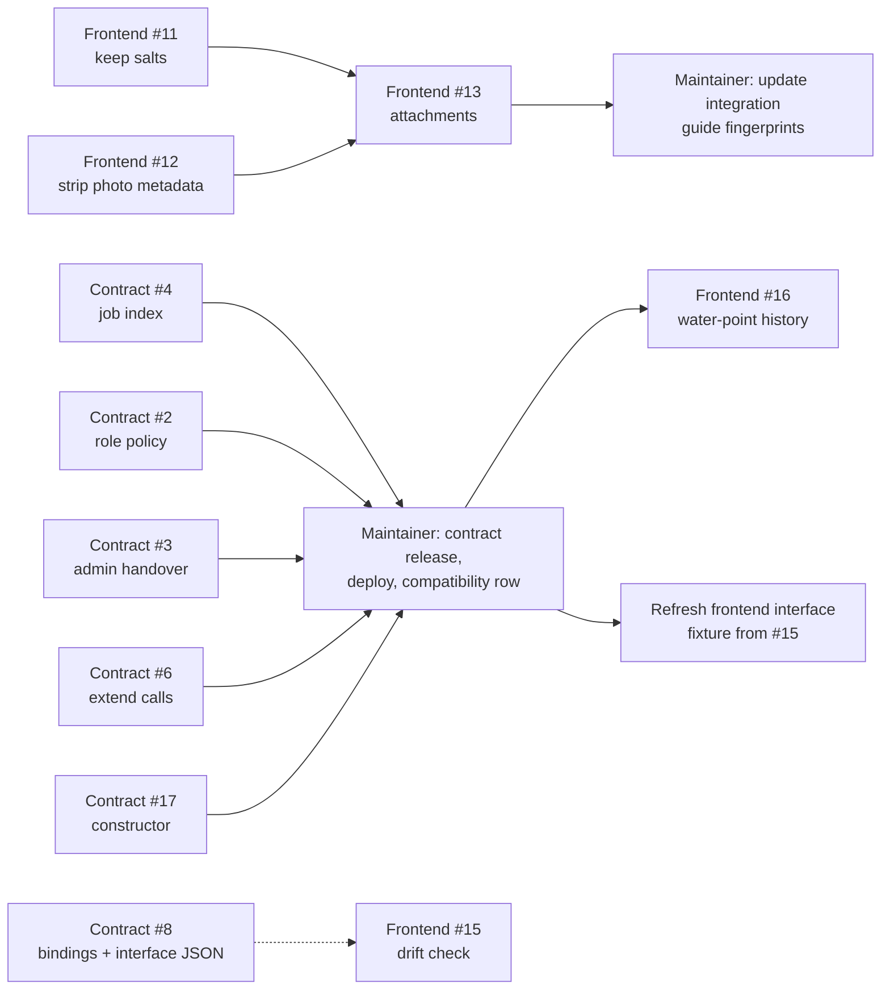

# Drips Wave backlog

Contributor backlog for [Drips Wave](https://www.drips.network/) cycles. It tracks which issues are ready, how they fit together, and what still has to happen before WaterUptime applies to a Wave.

Last updated: 2026-11-01, against contract `v0.2.0` (`main` at `f9820d0`) and frontend `v0.2.1`.

> Rewards follow the official rules of the Wave programme only. Maintainers never promise payment outside them. Read the current Drips maintainer docs before each cycle; programme details and labels change.

## Repository approval checklist

| Item | Status | Evidence |
|---|---|---|
| Public repositories with independent history | ✅ | [Contract](https://github.com/WaterUptime/WaterUptime-SmartContract), [frontend](https://github.com/WaterUptime/WaterUptime-Frontend), [hub](https://github.com/WaterUptime/WaterUptime), all created fresh in this organisation |
| README states problem hypothesis, MVP, setup, status and non-goals | ✅ | [Hub README](../README.md), plus each repository's README |
| Contract builds and tests pass in CI | ✅ | fmt, clippy, 39 tests and WASM build on every PR; green on `main` |
| Frontend builds and tests pass in CI | ✅ | Typecheck, tests and build on every PR; green on `main` |
| No secrets, personal data or production keys in source control | ✅ | Full git history scanned for secret-key patterns (0 hits); demo data is fictional |
| Architecture and threat assumptions documented | ✅ | [Architecture](../ARCHITECTURE.md), [security and privacy](security-and-privacy.md) |
| Demo uses synthetic data and Stellar testnet only | ✅ | [Testnet deployment](https://github.com/WaterUptime/WaterUptime-SmartContract/blob/v0.1.0/docs/TESTNET.md); app labels demo and testnet data |
| At least 4–6 scoped issues with acceptance criteria and test expectations | ✅ | 14 Wave-candidate issues across the three repositories, each with context, acceptance criteria, validation commands and one complexity level (below) |
| Contribution guide, Code of Conduct, private security reporting | ✅ | [Org `.github`](https://github.com/WaterUptime/.github); private vulnerability reporting enabled on all repositories |
| Tagged, compatible releases | ✅ | Contract `v0.2.0`, frontend `v0.2.1` (earlier releases listed too); [compatibility table](../README.md#compatibility) |
| Deployed contract source-verified on an explorer | ✅ | [Stellar Expert](https://stellar.expert/explorer/testnet/contract/CDO5G5UK4YLRCBXWJI7GSJYTPXZSZNCAQ4ILAKZHYUBA64QWWCUTF22Z) shows the source as verified; attested GitHub Actions build |
| Confirm the current Wave programme and cycle | ☐ | Maintainer action |
| Apply through the Drips app; wait for repository approval | ☐ | Maintainer action; organisers control approval |
| Add the programme's label to the issues selected for the cycle | ☐ | After approval |

## Open issues

Complexity follows the [Drips scale](https://www.drips.network/blog/posts/creating-meaningful-issues): **Trivial** (100 points), **Medium** (150) or **High** (200). Each issue states exactly one level. The level is set in the Drips app when the issue is added to a Wave: an issue added only through a GitHub label defaults to Trivial ([maintainer FAQ](https://docs.drips.network/wave/maintainers/faq)).

Every issue below was checked against the code on 2026-11-01. Each one has:
- the problem and why it matters;
- context;
- the goal;
- scope, including what is out of scope;
- objective acceptance criteria;
- the real validation commands;
- PR expectations;
- dependencies.

### Wave candidates

| Repository | Issue | Complexity | Notes |
|---|---|---|---|
| Frontend | [#11 Keep each record's salt so fingerprints can be re-checked](https://github.com/WaterUptime/WaterUptime-Frontend/issues/11) | Medium | Bug: today no fingerprint the app anchors can be re-checked. `bug`, `security-sensitive`. Prerequisite for #13 |
| Frontend | [#12 Remove location and camera metadata from evidence photos](https://github.com/WaterUptime/WaterUptime-Frontend/issues/12) | Medium | `security-sensitive`. Prerequisite for #13 |
| Frontend | [#13 Attach evidence files and let the verifier re-check them](https://github.com/WaterUptime/WaterUptime-Frontend/issues/13) | High | Needs #11 and #12 merged first. `security-sensitive` |
| Frontend | [#14 Cache finished jobs, limit concurrent RPC reads, report load failures correctly](https://github.com/WaterUptime/WaterUptime-Frontend/issues/14) | Medium | Includes a bug: a confirmed transaction is reported as failed if the refresh fails |
| Frontend | [#15 Fail tests when the contract interface and the frontend drift apart](https://github.com/WaterUptime/WaterUptime-Frontend/issues/15) | Medium | Independent |
| Contract | [#17 Set the coordinator in a constructor](https://github.com/WaterUptime/WaterUptime-SmartContract/issues/17) | Medium | Closes a front-running window on new deployments. `security-sensitive`, interface change |
| Contract | [#2 Admin-controlled role-separation policy](https://github.com/WaterUptime/WaterUptime-SmartContract/issues/2) | Medium | All rules off by default; the policy itself is a stakeholder decision. `security-sensitive`, interface change |
| Contract | [#3 Two-step admin handover](https://github.com/WaterUptime/WaterUptime-SmartContract/issues/3) | Medium | `security-sensitive`, interface change |
| Contract | [#4 Per-water-point job index, bounded and paginated](https://github.com/WaterUptime/WaterUptime-SmartContract/issues/4) | Medium | Interface change; unblocks frontend #16 |
| Contract | [#5 Exact payloads for every event](https://github.com/WaterUptime/WaterUptime-SmartContract/issues/5) | Trivial | `good first issue`, tests only |
| Contract | [#6 Permissionless calls that extend one job's records](https://github.com/WaterUptime/WaterUptime-SmartContract/issues/6) | Trivial | Interface change |
| Contract | [#7 Inventory of on-chain fields with a privacy checklist](https://github.com/WaterUptime/WaterUptime-SmartContract/issues/7) | Trivial | `good first issue`, docs only |
| Contract | [#8 TypeScript bindings and interface JSON in CI](https://github.com/WaterUptime/WaterUptime-SmartContract/issues/8) | Medium | Complements frontend #15 |
| Hub | [#1 Script that checks the compatibility table](https://github.com/WaterUptime/WaterUptime/issues/1) | Medium | Read-only checks against GitHub and testnet |

### Not offered as Wave issues

| Issue | Why |
|---|---|
| [Frontend #16 Water-point history from the job index](https://github.com/WaterUptime/WaterUptime-Frontend/issues/16) | Blocked until contract #4 is released and deployed |
| [Frontend #3 Evidence attachments](https://github.com/WaterUptime/WaterUptime-Frontend/issues/3) | Tracking issue for #11, #12 and #13 |
| [Frontend #4 SPA fallback for deep links](https://github.com/WaterUptime/WaterUptime-Frontend/issues/4) | Already being worked on in an outside contributor's PR ([#8](https://github.com/WaterUptime/WaterUptime-Frontend/pull/8)), awaiting maintainer review |
| [Contract #15 Restore archived records on testnet](https://github.com/WaterUptime/WaterUptime-SmartContract/issues/15) | Maintainer task that depends on dates (the `v0.1.0` instance archives from about 2026-11-26) |
| [Frontend #2 Wallet signing](https://github.com/WaterUptime/WaterUptime-Frontend/issues/2) | Closed. A manual check with the real Freighter extension is still a maintainer action |

## How issues depend on each other

Rules for interface-changing work:

1. A contract PR that adds or changes functions, errors or events updates `docs/CONTRACT_INTERFACE.md`. It doesn't bump the version or redeploy.
2. **New error codes:** take the next free number when the PR merges. Contract #2 and #3 both add errors, so whichever merges second renumbers. Existing codes never change.
3. **After merge, the maintainer:**
   - releases and redeploys;
   - updates [contract-state-machine.md](contract-state-machine.md);
   - refreshes the frontend's interface fixture (frontend #15) and adds messages for new errors;
   - adds a row to the [compatibility table](../README.md#compatibility).
4. Contract #2, #3 and #17 all touch admin logic in `lib.rs`. They can run in the same cycle, but expect rebases.

## Suggested cycle plan

Pick a mix of sizes, and keep each issue small enough to finish within one cycle.

| Slot | Contract | Frontend | Hub |
|---|---|---|---|
| Newcomer | #5, #7 | — | — |
| Standard | #6, #4, #8 | #14, #15 | #1 |
| Security-sensitive (experienced contributors, careful review) | #17, #2, #3 | #11, #12 | — |
| Second half of the cycle, or next cycle | — | #13 (after #11 and #12) | — |

If you want to avoid overlapping work in one cycle, offer #13 only once #11 and #12 have merged. Hold #16 until contract #4 is deployed.

## Not ready to file yet

These need a decision or design first, so they aren't open issues:

| Idea | Waiting on |
|---|---|
| Off-chain evidence store (server side) | Data-protection design after [Gate C](../ROADMAP.md#m3-fit-and-design--gates-b-c-d) |
| Integration with existing WASH systems | [User research](user-research.md) and data-owner permission |
| Offline-first field capture | Discovery findings on connectivity |
| Accessibility review with assistive technology | A reviewer with assistive-technology experience. An automated axe scan on 2026-11-01 found no violations at 390 and 1280 px, except one heading-order warning on the jobs page; that is too small for a Wave issue |
| Choosing a role-separation policy for a real deployment | Stakeholder decision (contract #2 only makes it configurable) |

Payments, tokens, AI features and mainnet are out of scope ([product requirements](product-requirements.md#explicit-exclusions-for-v0)) and won't become Wave issues.

## What happened to the original backlog

The starter backlog proposed eight issues. The first milestone delivered most of them, so they were replaced by the issues above.

| Original issue | Outcome |
|---|---|
| 1. State enum and lifecycle transition tests | Done in contract `v0.1.0` |
| 2. Role separation for assignment | Done in `v0.1.0`; the optional stricter policy is now contract #2 |
| 3. Reporter authorisation | Done in `v0.1.0` |
| 4. Audit events for every state change | Done in `v0.1.0`; exact payload tests for the rest are contract #5 |
| 5. End-to-end contract test | Done: unit tests plus `scripts/testnet-demo.sh` on testnet |
| 6. Data minimisation doc | Partly covered by [security and privacy](security-and-privacy.md); contract checklist is contract #7 |
| 7. Mobile-first job lifecycle view (mock data) | Done in frontend `v0.1.0` |
| 8. Testnet demo instructions | Done: contract `docs/TESTNET.md` |

## Maintainer habits for each cycle

- Before a cycle: re-read the Drips docs, re-check that each selected issue still matches the code, and add the programme label.
- Explain the problem, the files likely affected, the acceptance criteria and the test commands in every issue.
- Reply to applications and PRs promptly; ask for changes respectfully; merge only when the acceptance criteria and CI pass.
- Give `security-sensitive` PRs a second careful review. A working happy path is not enough.
- Close stale or invalid issues, and keep this document and the [roadmap](../ROADMAP.md) in sync after each cycle.
