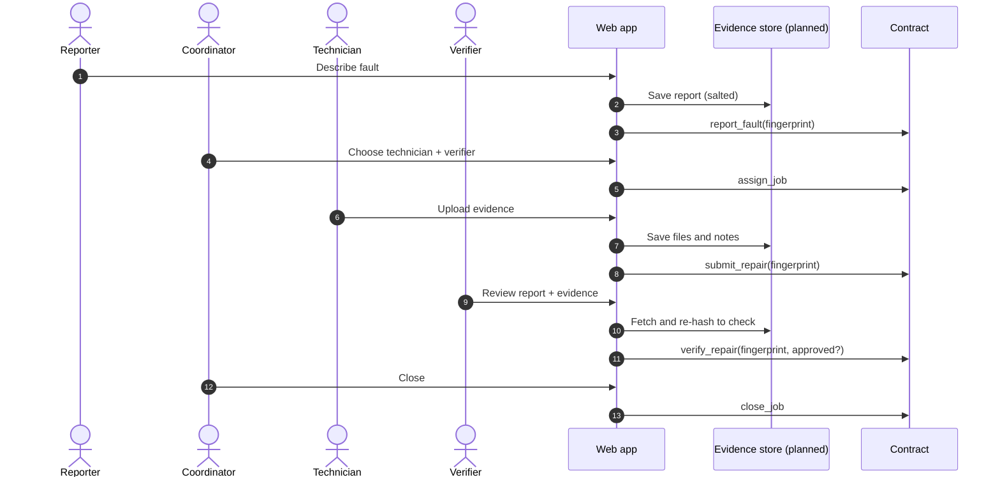

# System architecture

Overview: [ARCHITECTURE.md](../ARCHITECTURE.md). This document covers components, data flow, storage, deployment and the trust model in more detail.

## Components

### 1. Soroban contract (`water_uptime`)

Repository: [WaterUptime-SmartContract](https://github.com/WaterUptime/WaterUptime-SmartContract) · Rust · `soroban-sdk 27`

| Module | Responsibility |
|---|---|
| `lib.rs` | Entry points and the state machine ([contract-state-machine.md](contract-state-machine.md)) |
| `types.rs` | `WaterPoint`, `MaintenanceJob`, `JobStatus`, `AuditEntry`, `Error`, storage keys |
| `events.rs` | `#[contractevent]` definitions |
| `storage.rs` | Storage access and TTL extension |

**Storage**

| Kind | Keys | Notes |
|---|---|---|
| Instance | `Admin`, `JobCount` | Extended ~30 days on use |
| Persistent | `Reporter(Address)`, `WaterPoint(id)`, `Job(u64)`, `History(u64)` | Extended ~120 days on read or write |

Entries nobody touches will eventually be archived and need restoring. Explicit extension is planned ([contract #6](https://github.com/WaterUptime/WaterUptime-SmartContract/issues/6)). Water points are not enumerable on-chain; a per-point job index is planned ([contract #4](https://github.com/WaterUptime/WaterUptime-SmartContract/issues/4)).

### 2. Web app

Repository: [WaterUptime-Frontend](https://github.com/WaterUptime/WaterUptime-Frontend) · Vite · React 19 · TypeScript · Tailwind CSS v4

| Layer | Path | Responsibility |
|---|---|---|
| Domain | `src/domain/` | Contract-mirroring types, state-machine port, error messages, hashing |
| Data | `src/data/` | Demo seed and store; testnet reads and signed writes (`testnet.ts`); Freighter connection (`wallet.ts`); config |
| UI | `src/components/`, `src/pages/` | Role-aware pages, audit timeline, lifecycle stepper |

**Data sources**

| Mode | Reads from | Writes to |
|---|---|---|
| Demo (default) | Synthetic seed in `localStorage` | The same; enforced by `workflow.ts` |
| Testnet | Contract, via `@stellar/stellar-sdk` `contract.Client.from` (simulated reads, no wallet) | Contract, from frontend `v0.2.0`: simulate, sign in Freighter, submit, wait for the ledger, reload. Typed descriptions stay in the browser's `localStorage`; only fingerprints go on-chain |

The SDK is loaded with a dynamic `import()` only when testnet mode opens. The default bundle is ~100 KB gzipped; the SDK chunk adds ~130 KB gzipped.

### 3. Off-chain evidence store (planned)

Holds fault reports, repair photos and logs, verification notes and facility records, behind access control. Only salted fingerprints of these records go on-chain. The client side is planned in [frontend #3](https://github.com/WaterUptime/WaterUptime-Frontend/issues/3); the server side needs design after [Gate C](../ROADMAP.md#m3-fit-and-design--gates-b-c-d).

### 4. Existing WASH systems (external)

Where systems such as WASHIMS or functionality-tracking tools are in use, they remain the system of record. Integration is read-only, permission-first and comes after discovery. See [integration-guide.md](integration-guide.md#integrating-existing-wash-systems).

## Data flow: one repair

Today, steps that write to the contract happen only through the CLI or the demo script. The app performs them in demo mode, in the browser.

## What lives where

| Data | On-chain | Off-chain |
|---|---|---|
| Water-point ID | Random 32 bytes | Mapping to a human-readable code |
| Facility name, type, locality | Fingerprint only | Record |
| Exact location | **Never** | Only if required, under access control |
| Fault description, priority | Fingerprint only | Record |
| Repair notes, photos, logs | Fingerprint only | Files and record |
| Verifier notes and reason | Fingerprint only | Record |
| Who did what, when | Addresses and ledger timestamps | Display names and roles |
| Personal data | **Never** | Only with purpose, consent and access control |

## Deployment

| Environment | Contract | App |
|---|---|---|
| Local | `cargo test`; optional local network | `npm run dev` |
| Testnet (shared) | ID in the [compatibility table](../README.md#compatibility) and the contract's `docs/TESTNET.md` | Run locally; static hosting planned ([frontend #4](https://github.com/WaterUptime/WaterUptime-Frontend/issues/4)) |
| Mainnet | **Not permitted** ([Gate E](../ROADMAP.md#m4-pilot-readiness--gate-e)) | — |

## Trust model

| The system can show | The system cannot show |
|---|---|
| Which account submitted each step, and when | That the account holder is who they claim to be |
| That the technician and verifier were different accounts | That they are independent people without collusion |
| That evidence hasn't changed since submission (fingerprint matches) | That the evidence is genuine or the repair was done well |
| That a job followed the allowed order of steps | That water is flowing, or is safe to drink |

These gaps are closed, if at all, by governance: accountable roles, credible verification procedures, key management, dispute handling and spot checks. See [security-and-privacy.md](security-and-privacy.md).
